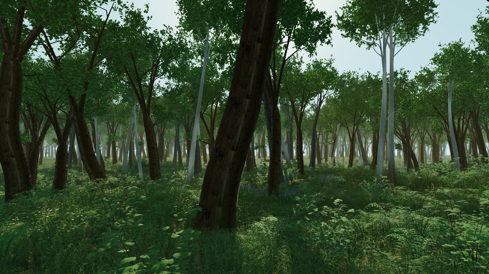

# Verdant Forest

A walkable, fully procedural temperate woodland for Windows, built in Godot 4.7. Every tree, fern, flower, rock and
leaf is generated when it starts: no models ship with it. Oak, beech and birch, bluebell and anemone drifts, moss on
the rocks, ivy on the trunks, floating motes and late-afternoon light through the canopy.

This is a Godot port of **Verdant Forest**, a procedural three.js woodland by **Leon Lin** ([@LexnLin](https://x.com/LexnLin)). The port
reproduces the original's generators exactly, so the same 7,155 trees grow in the same places.

## Download and play

1. Download `VerdantForest-windows.zip` from the **Releases** page and unzip it anywhere.
2. Run `VerdantForest.exe`. The forest takes about 15 seconds to grow the first time you open it.

Needs Windows 10 or 11 and a graphics card with Vulkan support. It runs at 60-80 fps at 2560x1440 on an RTX 5080.
Slower cards will want a smaller window.

## Controls

| Movement | | Settings (panel, bottom left) | |
|---|---|---|---|
| Move | W A S D | Fullscreen | F11 |
| Rise | Space | Anti-aliasing | T |
| Descend | E | Frame rate | F3 |
| Sprint | Shift | Walkable edge | B |
| Zoom | Mouse wheel | Back to the trail | R |
| Look | Mouse | Hide the panel | H |

The mouse is captured for looking. Esc frees it so you can click the panel; Esc again quits. Your settings are kept
between runs.

## Run from source

Install [Godot 4.7](https://godotengine.org/download), then open this folder in Godot and press Play. Or set the
`GODOT` environment variable to your Godot executable and run `Play Verdant Forest.bat`.

Command-line options go after `--`: `--view=entrance|ferns|grove|deadwood|canopy|ridge|reverse|aerial`, `--w=1920
--h=1080`, `--cam=x,y,z,tx,ty,tz` (camera and target, heights above the ground), `--fov`, `--border`, `--bench`.

## How it's built

- `forest_math.gd`: the original's seeded random generators, noise, terrain and trail, with JavaScript's 32-bit
  integer maths reproduced exactly.
- `tree_gen.gd`, `vegetation.gd`: the tree generator (swept trunks, root buttresses, boughs, twigs, cupped leaves) in
  three detail levels, built on worker threads, and the tree placement and level-of-detail system.
- `plants_gen.gd`, `understory.gd`, `flowers.gd`: grass placed on the GPU, ferns, shrubs, herbs and wildflower drifts.
- `surfaces.gd`, `details.gd`, `fungus.gd`, `floor_detail.gd`: moss rocks, fallen logs, leaf litter, mushrooms, moss,
  roots, twigs, acorns, ivy, bracket fungus, sorrel and pebbles.
- `atmosphere.gd` and `shaders/`: floating motes, light shafts through volumetric fog, distance haze and the colour
  grade.
- `forest.gd`, `settings_ui.gd`: sky, sun, terrain, the camera and the settings panel.

## Credits

- Original Verdant Forest (three.js): **Leon Lin** ([@LexnLin](https://x.com/LexnLin)).
- Bark, ground and rock textures: Rob Tuytel, [Poly Haven](https://polyhaven.com) (CC0). See `textures/CREDITS.txt`.
- Built with [Godot Engine](https://godotengine.org) (MIT).

## Licence

MIT; see `LICENSE`. The Poly Haven textures are CC0.
